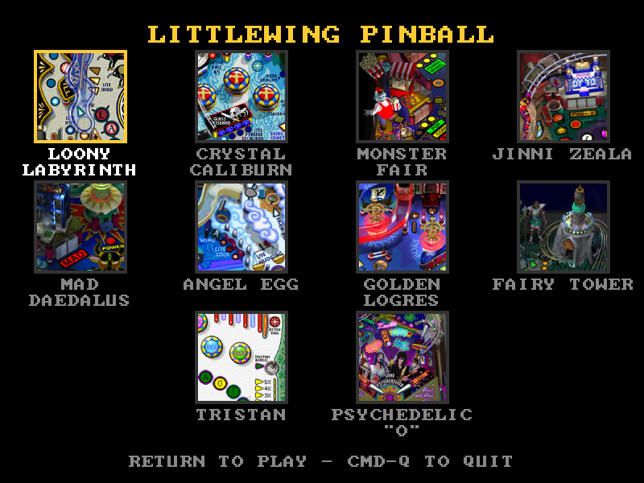

# LittleWing

Play LittleWing's classic Mac pinball games on an Apple Silicon Mac. The
games were written for PowerPC Macs and don't run on today's Macs by
themselves; LittleWing.app runs them for you.



This is an unofficial project, not made or endorsed by LittleWing. It
contains no game files: you need your own copies of the games.

## Quick start

1. **Get the app.** Download
   [LittleWing.zip](https://github.com/gregjkal/littlewing-shim/releases/latest/download/LittleWing.zip),
   the latest release, unzip it, and move `LittleWing.app` to your
   Applications folder. Earlier versions are on the
   [Releases](https://github.com/gregjkal/littlewing-shim/releases) page.
2. **Get a game.** Download one from LittleWing's [download
   page](http://www.littlewingpinball.com/doc/en/downloads/index.html),
   Loony Labyrinth for example, and put it in your Applications folder.
3. **Play.** Double-click LittleWing.app. The game starts registered and
   plays its opening, then a self-playing demo. Press **Esc** to stop the
   demo, Esc again for the game's menu, and choose to start a game.

| Key | Does |
|---|---|
| Z | Left flipper |
| / | Right flipper |
| Return | Hold and release to pull the plunger; choose in a menu |
| Space | Nudge |
| Esc | Stop the demo, open the menu; in a game, pause |
| Cmd-F | Full screen on or off |
| Cmd-Q | Quit |

You can change the keys from the game's OPTIONS menu.

## Installing more games

LittleWing.app runs all ten of LittleWing's PowerPC Mac games:

| Game | First released |
|---|---|
| Tristan 2.5.1 (Internet Edition) | 1992 |
| Angel Egg 3.0.1 | 1996 |
| Loony Labyrinth 3.0.1 | 2003 |
| Crystal Caliburn 3.0.1 | 2003 |
| Jinni Zeala 1.2.2 | 2004 |
| Golden Logres 3.0.4 | 2005 |
| Psychedelic "O" 1.2.3 | 2006 |
| FAIRY TOWER 1.1.7 | 2008 |
| MONSTER FAIR 1.2.5 | 2010 |
| Mad Daedalus 1.1.9 | 2010 |

Download any of them from LittleWing's [download
page](http://www.littlewingpinball.com/doc/en/downloads/index.html) and put
it in your Applications folder, or in a folder inside it, such as
`/Applications/LittleWing Games/`. The app finds it the next time it opens.
With two or more games installed, the app opens on the picker shown above.

### Psychedelic "O"

Psychedelic "O" isn't on LittleWing's download page: it came only on a
bonus disc for the band LOVE PSYCHEDELICO. The disc is on the [Internet
Archive](https://archive.org/details/littlewing-pinball-psychedelic-o):
download [`Psychedelic O Pinball (Bonus Disc).zip`](https://archive.org/download/littlewing-pinball-psychedelic-o/Psychedelic%20O%20Pinball%20%28Bonus%20Disc%29.zip)
(54 MB) to your Downloads folder and unzip it (Safari unzips it for you),
which gives you a folder named `Psychedelic O Pinball (Bonus Disc)`.

The disc's Mac installer doesn't run on today's macOS, so copy the game out
of it instead. In Terminal, run:

```bash
cd ~/Downloads/"Psychedelic O Pinball (Bonus Disc)"
hdiutil attach MAC/SETUP.DMG
mkdir '/Applications/Psychedelic"O"'
ditto -x -z '/Volumes/Psychedelic"O"/Psychedelic"O".pkg/Contents/Archive.pax.gz' '/Applications/Psychedelic"O"'
hdiutil detach '/Volumes/Psychedelic"O"'
```

This makes a folder named `Psychedelic"O"` in Applications, holding the
program `Psychedelic''O''` and a `Psychedelic"O" Data` folder. Keep the
folder's name as it is. You can move it into a games folder inside
Applications, like the others.

## Features

**The picker.** Choose a game with the arrow keys or the mouse, and press
Return or click to play. The selected game's opening music plays (the first
time you see a game, its card is silent for a few seconds while the app
fetches the music from your copy). The app starts on the last game you
played. Choosing QUIT in a game's own menu goes back to the picker.

**Every game starts registered.** LittleWing's store is gone, so no key can
be bought. The app registers each game for you, and the full game plays
from the first launch.

**Game-specific controls.** Every game uses the keys above, with a few
additions:

- MONSTER FAIR and Jinni Zeala nudge the table's left and right sides with
  X and . (period).
- In Jinni Zeala, Psychedelic "O", Mad Daedalus and FAIRY TOWER, the first
  Esc opens the menu.
- Angel Egg, Golden Logres and Tristan start a game with Cmd-N. In Angel
  Egg and Golden Logres, Esc pauses; Golden Logres's Esc first skips its
  opening story, then the title.
- Angel Egg, Golden Logres and Tristan have menus of their own, which
  appear in the Mac's menu bar. In full screen, move the pointer to the top
  of the screen to show it.

**Volume.** The **Sound** menu has a volume slider, remembered for every
game.

**HD art.** Loony Labyrinth plays at 4 times its original resolution, with
redrawn art for its pictures. It's on automatically.

**Replays, clips and practice** (Loony Labyrinth). Every game you play is
recorded. You can:

- Press **Cmd-S** during play to mark a great moment, then export a video
  clip of it from the **Replay** menu.
- Watch any recent game from the **Replays** menu, with YouTube's keys to
  pause, skip and step frame by frame.
- Share the replay of a high score from the **High Scores** menu, by
  AirDrop, Mail or Messages. Double-click a `.lwreplay` file someone sends
  you to watch it.
- Practice from a moment you marked, or one the app ships, as many times
  as you like, from the **Replays** or **Practice** menus.

The [replay guide](docs/replays.md) has the details.

**Saved games and settings.** Each game's options, keys and high scores are
kept in `~/Library/Application Support/littlewing-shim/<game>/`. The
original game files are never changed. Delete a game's folder there to
start it over.

**Updates.** The app checks for a new version once a day and offers to
install it. **LittleWing → Check for Updates…** checks now.

**If something goes wrong,** the app says so in a message box. Its log is
`~/Library/Logs/littlewing-shim/loony.log`; please attach it when you
[report an issue](https://github.com/gregjkal/littlewing-shim/issues).

## More reading

- [Replays, clips and practice](docs/replays.md): everything about
  recording, watching, clipping and sharing Loony Labyrinth games.
- [Development](docs/development.md): building from source, running from a
  terminal, every `LOONY_*` setting, debugging, tests, HD art and releases.
- [Design](docs/superpowers/specs/2026-09-30-loony-shim-design.md): how
  the emulator and the reimplemented Mac OS fit together.

## License

littlewing-shim is free software: you can redistribute it and/or modify it
under the terms of the GNU General Public License as published by the Free
Software Foundation, either version 2 of the License, or (at your option) any
later version. See `LICENSE`.

The app bundles Unicorn (GPLv2), with the changes in `tools/unicorn-patches`,
and SDL3 (zlib license). Their licenses are in
`LittleWing.app/Contents/Resources/Licenses`. The games, and the art in
`hd-art/` made from them, belong to LittleWing and aren't covered by this
license.
